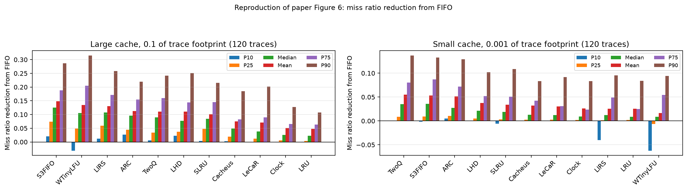

# Reproducing S3-FIFO (SOSP '23)

Course reproduction of:

> Juncheng Yang, Yazhuo Zhang, Ziyue Qiu, Yao Yue, K. V. Rashmi.
> **FIFO queues are all you need for cache eviction.**
> SOSP '23, Koblenz, Germany, pp. 130-149.
> https://doi.org/10.1145/3600006.3613147

S3-FIFO is a cache eviction algorithm built from three FIFO queues: a small one
`S` holding 10% of the cache, a main one `M` holding the other 90%, and a ghost
queue `G` that stores keys only. New objects enter `S` unless their key is in
`G`, in which case they go straight to `M`. Each object carries a 2-bit counter
capped at 3. The claim is that most web cache objects are "one-hit wonders" that
are never requested again, so a small queue can flush them out before they
pollute the cache, and that this beats far more complicated LRU-based designs.

## At a glance

Across **120 traces and 2.52 billion requests**, replaying two of the paper's
datasets in full, the central claim holds. On the large cache size S3-FIFO gives
the lowest miss ratio of the eleven algorithms tested, and its mean reduction
over FIFO of **14.8%** matches the 14% the paper reports.



S3-FIFO also keeps a positive P10 at both cache sizes, where TinyLFU and LIRS
fall below zero: on the worst tenth of traces those two are beaten by plain
FIFO. Full numbers, and the one place our results diverge, are in
[Results](#results) below.

Two things turned up that are not visible from reading the paper:

- Its prose and its pseudocode disagree in two places, and the implementation
  that matches the authors' reference takes one detail from each. See
  [Notes on the paper](#notes-on-the-paper).
- The public trace dataset indexes `next_access_vtime` from 0 in one dataset and
  from 1 in another, which silently corrupts any analysis that assumes one
  convention.

## What is reproduced

The paper evaluates 6594 traces across 14 datasets, totalling several TB. Two of
those datasets are small enough to run on a laptop, and both are reproduced
**in full**, every trace, not a sample:

| Dataset | Traces | Requests | Download |
|---|---|---|---|
| MSR Cambridge 2007 | 14 | 410M | 1.6 GB |
| CloudPhysics 2015 | 106 | 2114M | 9.0 GB |

| Our figure | Paper figure | What it shows |
|---|---|---|
| `figures/fig3_one_hit_wonder.png` | Figure 3, Table 1 | One-hit-wonder ratio against sequence length |
| `figures/fig6_miss_ratio_reduction.png` | Figure 6 | Miss ratio reduction from FIFO, by percentile |
| `figures/fig7_per_dataset.png` | Figure 7 | Mean miss ratio reduction per dataset |
| `figures/fig11_small_queue.png` | Figure 11 | Sensitivity to the size of the small queue `S` |

Not reproduced, and out of scope for a laptop: Figure 8 (throughput scaling
across 16 CPU cores) and the Cachelib prototype results, which need a
dual-socket server, and Figure 9's flash write-amplification results.

## Results

Everything below comes from the CSVs in `results/`, over 120 traces and
2.52 billion requests. `python run.py 7` reprints these numbers.

### One-hit-wonder ratio (paper Table 1 and Figure 3)

All six tabulated values reproduce within 0.04:

| Dataset | Sequence length | Paper | Ours | Diff |
|---|---|---|---|---|
| MSR | full trace | 0.56 | 0.54 | -0.02 |
| MSR | 10% of objects | 0.74 | 0.77 | +0.03 |
| MSR | 1% of objects | 0.86 | 0.85 | -0.01 |
| CloudPhysics | full trace | 0.40 | 0.41 | +0.01 |
| CloudPhysics | 10% of objects | 0.71 | 0.75 | +0.04 |
| CloudPhysics | 1% of objects | 0.80 | 0.83 | +0.03 |

Our MSR traces total 409.8M requests against the paper's stated 410M, so the
underlying data matches.

### Miss ratio reduction from FIFO (paper Figures 6 and 7)

Mean over all 120 traces:

| Rank | Large cache (10% of footprint) | | Small cache (0.1%) | |
|---|---|---|---|---|
| 1 | **S3-FIFO** | 0.1479 | TwoQ | 0.0548 |
| 2 | WTinyLFU | 0.1348 | **S3-FIFO** | 0.0533 |
| 3 | LIRS | 0.1307 | ARC | 0.0513 |
| 4 | ARC | 0.1128 | LHD | 0.0375 |

S3-FIFO ranks first of eleven at the large cache size, which is the paper's
central claim. At the small size it falls to second behind TwoQ. That is
consistent with the paper's own explanation: when the cache is very small, new
objects are evicted before they can demonstrate popularity, while TwoQ reserves
a fixed fraction of space for new objects.

Two details visible in the figures that are worth noting:

- In Figure 6, S3-FIFO keeps a positive P10 at both cache sizes, while WTinyLFU
  and LIRS go negative, meaning they are worse than plain FIFO on the bottom
  decile of traces. This supports the paper's robustness argument.
- In Figure 7, the win is driven by CloudPhysics. On MSR alone ARC very
  slightly edges S3-FIFO (0.132 against 0.131); on CloudPhysics S3-FIFO is well
  ahead (0.151 against 0.110).

### Size of the small FIFO queue (paper Figure 11)

Mean reduction over the 14 MSR traces:

| Size of S | Large cache | Small cache |
|---|---|---|
| 0.01 | 0.1336 | -0.0008 |
| 0.05 | **0.1373** | 0.0189 |
| 0.10 (paper's choice) | 0.1312 | 0.0239 |
| 0.25 | 0.1186 | **0.0259** |
| 0.50 | 0.0858 | 0.0237 |

This one only partly agrees with the paper. The optimum is shallow, but on MSR
it sits at 5% for the large cache and 25% for the small one rather than at the
paper's 10%. The paper chose 10% from experiments on 10 traces drawn from all 14
of its datasets, and says it "generalizes well" rather than that it is optimal
everywhere. On this single dataset 10% is within about 0.6 percentage points of
the best setting at both cache sizes, so it reads as a reasonable compromise
whose best value shifts with cache size, not as a contradiction.

### Not reproduced

Figure 8 (throughput scaling across 16 CPU cores) and the Cachelib prototype
results need a dual-socket server rather than a laptop. Figure 9's flash
write-amplification results are also out of scope. Of the paper's 14 datasets,
12 were omitted for size: the full set runs to several TB, against 11 GB for the
two reproduced here.


## Setup

Needs Python 3.10 to 3.13 on arm64 macOS 15+ or Linux, where `libcachesim`
installs as a prebuilt wheel. On Python 3.14 pip falls back to compiling from
source, which pulls in CMake, Ninja, GLib and zstd, so pin 3.12.

```bash
uv venv --python 3.12 --seed
source .venv/bin/activate
uv pip install libcachesim matplotlib pandas numpy
```

The `zstd` command line tool is also needed for the trace decoding in
experiment 1 (`brew install zstd`).

## Running

```bash
python run.py
```

Pick a step from the menu, or pass its number directly (`python run.py 4`).

1. **Download traces.** Fetches both datasets with `curl` into libcachesim's
   cache directory. About 11 GB. libcachesim can fetch `s3://` URIs itself but
   does so at roughly 100 KB/s here, where curl against the same bucket sustains
   about 6 MB/s.
2. **Experiment 1, one-hit-wonder ratio.** Pure trace analysis, no cache
   simulation. The cheapest check that the trace decoding is right, since its
   output is directly comparable to the paper's Table 1.
3. **Validate our S3-FIFO.** Compares `s3fifo.py`, transcribed by hand from the
   paper's Algorithm 1, against libcachesim's reference C++ implementation.
4. **Experiment 2, miss ratios.** The simulation workhorse: 12 algorithms over
   every trace at two cache sizes. Roughly 2 hours across both datasets on 8
   cores. Parallel and resumable, so it can be interrupted and restarted.
5. **Experiment 4, small queue sweep.** Varies the size of `S` to check the
   paper's 10% choice.
6. **Regenerate figures** from the CSVs in `results/`, without re-simulating.
7. **Compare against the paper**, printing the numbers that can be checked
   directly.

## Layout

```
run.py                        menu entry point
traces.py                     dataset registry, downloads, fast numpy trace loader
s3fifo.py                     our own S3-FIFO, from the paper's Algorithm 1
validate.py                   our implementation vs the libcachesim reference
plots.py                      one function per reproduced figure
experiments/
  exp1_one_hit_wonder.py      paper Figure 3 and Table 1
  exp2_miss_ratio.py          paper Figures 6 and 7
  exp4_small_queue.py         paper Figure 11
results/                      CSVs, so figures redraw without re-simulating
figures/                      output PNGs
```

## Notes on the paper

Two places where the paper's prose and its pseudocode disagree, both resolved
empirically in `validate.py` by testing all four combinations against the
reference implementation:

- **Promotion threshold.** Pseudocode line 23 promotes the tail of `S` to `M`
  when `freq > 1`. Section 4.1's prose says the object moves "if it is accessed
  more than once", which reads as `freq >= 1`. The pseudocode is right, and
  libcachesim's own `move_to_main_threshold` default of 2 agrees.
- **Clearing frequency on promotion.** Section 4.1 says the access bits are
  cleared when an object moves from `S` to `M`. The pseudocode does not show
  this. The prose is right.

Taking the pseudocode's threshold with the prose's reset matches the reference
implementation to within 0.0014 absolute miss ratio.

The public dataset is also inconsistent about the `next_access_vtime` field.
MSR's `.oracleGeneral.zst` files index requests from 0, while CloudPhysics's
`.oracleGeneral.bin.zst` files index from 1, and a few traces carry a single
pointer one past the last request. Assuming one base silently mislabels every
next pointer in the other dataset, so `traces.load_prev_next` detects the base
per trace and the result is cross-checked against an independent object count.

One difference in the trace data: the paper's Table 1 lists 13 MSR traces after
excluding any with fewer than 1 million requests, but the public dataset has 14
files that all clear that cutoff. Our 14 traces total 409.8M requests against
the paper's stated 410M, so the underlying data appears to be the same.
